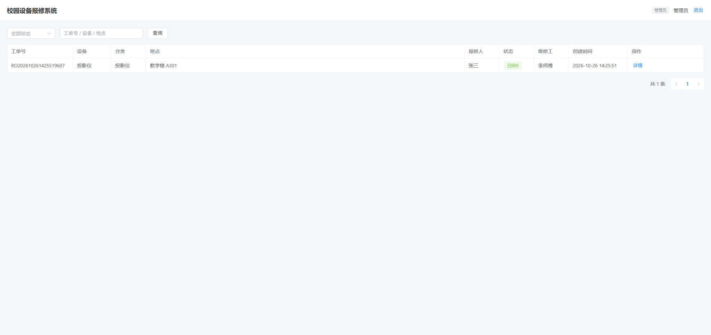
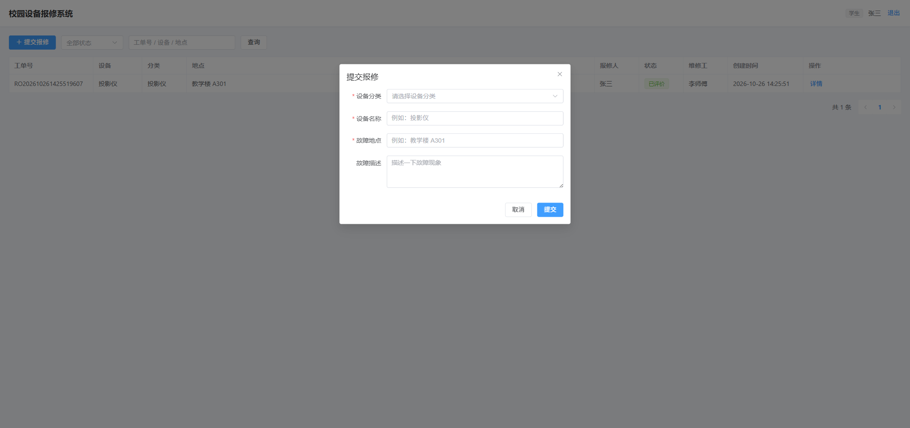
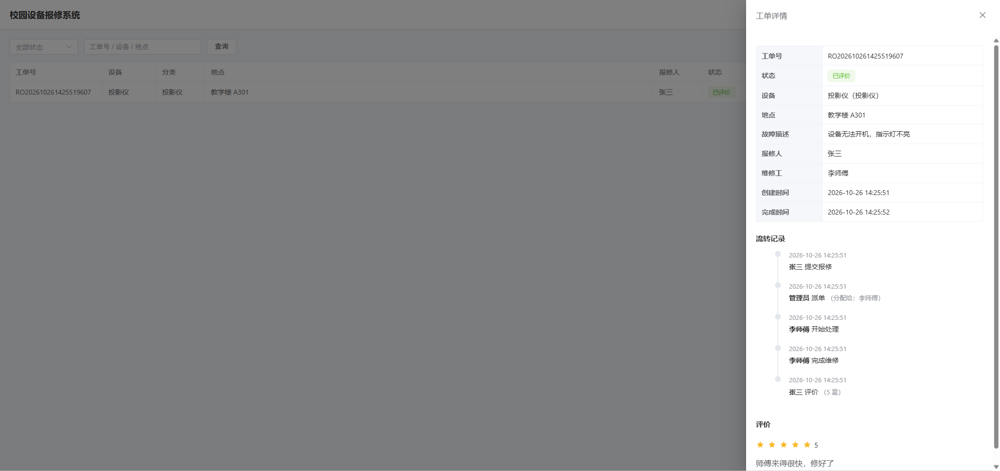

# 校园设备报修系统

一个基于 Spring Boot 的校园设备报修工单管理系统，覆盖 **学生报修 → 管理员派单 → 维修工处理 → 学生评价** 的完整业务闭环，支持三种角色的权限隔离与工单全流程留痕。

## 界面预览

| 登录页 | 工单列表 |
|---|---|
|  |  |

| 提交报修 | 工单详情 |
|---|---|
|  |  |

## 功能特性

- **登录认证**：JWT 无状态认证，自定义拦截器校验 token；登出 / 禁用 / 删除 / 重置密码后即时吊销旧 token（Redis 水位线）
- **角色权限**：STUDENT / REPAIRER / ADMIN 三种角色，注解式接口权限控制
- **用户管理**：分页查询、新增、修改、删除、启用/禁用、重置密码
- **设备分类**：分类的增删改查，被工单引用时禁止删除
- **报修工单**：提交、分页查询、详情、派单、开始处理、完成、评价
- **状态机**：待派单 → 已派单 → 处理中 → 已完成 → 已评价，非法流转直接拦截
- **流转留痕**：每次状态变更写入 `order_log`，详情页可查看完整处理轨迹
- **数据隔离**：学生只能看自己的工单，维修工只能看派给自己的工单
- **分类缓存**：分类列表走 Redis 缓存，增删改自动失效，Redis 异常时降级查库
- **Web 管理界面**：Vue 3 + Element Plus 页面，支持登录、报修、派单、处理、评价全流程

## 技术栈

| 技术 | 版本 | 用途 |
|---|---|---|
| JDK | 1.8 | 运行环境 |
| Spring Boot | 2.7.18 | 基础框架 |
| MyBatis-Plus | 3.5.5 | ORM、分页、逻辑删除 |
| MySQL | 8.0 | 数据库 |
| Hutool | 5.8.25 | JWT、MD5、工具类 |
| Redis | 7.x | 分类列表缓存 |
| Knife4j | 4.4.0 | 在线接口文档 |
| Lombok | - | 简化实体代码 |
| Vue 3 | 3.4 | 前端框架（本地化引入，无需构建） |
| Element Plus | 2.8 | 前端 UI 组件库 |

## 快速开始

### 1. 环境要求

- JDK 8+
- Maven 3.6+
- MySQL 8.0+
- Redis 7+（可用 Docker 启动）

### 2. 启动 Redis

```bash
docker run -d --name repair-redis -p 6379:6379 redis:7
```

> Redis 不在本地时，修改 `application.yml` 中的 `spring.redis.host` 和 `port`。

### 3. 初始化数据库

```bash
mysql --default-character-set=utf8mb4 -uroot -p < sql/init.sql
```

> 脚本会自动创建 `repair_system` 数据库、6 张表和初始化数据。

### 4. 修改数据库配置

编辑 `src/main/resources/application.yml`，把密码改成你的 MySQL 密码：

```yaml
spring:
  datasource:
    username: root
    password: ${MYSQL_PASSWORD:root}   # 默认 root，或设置环境变量 MYSQL_PASSWORD
```

### 5. 启动项目

```bash
mvn spring-boot:run
```

### 6. 访问系统

- **Web 管理页面**：http://localhost:8080/
- **接口文档**：http://localhost:8080/doc.html

## 测试账号

| 账号 | 密码 | 角色 | 说明 |
|---|---|---|---|
| admin | 123456 | 管理员 | 用户管理、派单 |
| student | 123456 | 学生 | 提交报修、评价 |
| repairer | 123456 | 维修工 | 处理工单 |

> 密码使用 BCrypt 加盐哈希存储（`init.sql` 种子账号亦为 BCrypt）。登录校验按 `$2` 前缀区分格式，兼容历史遗留的 MD5 账号，迁移完成后可移除 MD5 分支。

## 接口一览

### 认证

| 方法 | 路径 | 说明 |
|---|---|---|
| POST | `/api/auth/login` | 登录 |
| POST | `/api/auth/logout` | 登出（吊销当前账号已签发的全部 token） |
| GET | `/api/auth/me` | 当前登录用户 |

### 用户管理（ADMIN）

| 方法 | 路径 | 说明 |
|---|---|---|
| GET | `/api/users/page` | 分页查询 |
| POST | `/api/users` | 新增 |
| PUT | `/api/users` | 修改 |
| DELETE | `/api/users/{id}` | 删除（逻辑删除） |
| PUT | `/api/users/{id}/status` | 启用/禁用 |
| PUT | `/api/users/{id}/reset-password` | 重置密码 |

### 角色 / 分类

| 方法 | 路径 | 说明 |
|---|---|---|
| GET | `/api/roles/list` | 角色列表（ADMIN） |
| GET | `/api/categories/list` | 分类列表 |
| POST/PUT/DELETE | `/api/categories` | 分类增删改（ADMIN） |

### 报修工单

| 方法 | 路径 | 角色 | 说明 |
|---|---|---|---|
| POST | `/api/orders` | STUDENT | 提交报修 |
| GET | `/api/orders/page` | 全部 | 分页查询（按角色过滤） |
| GET | `/api/orders/{id}` | 全部 | 详情（含流转记录） |
| PUT | `/api/orders/assign` | ADMIN | 派单 |
| PUT | `/api/orders/{id}/start` | REPAIRER | 开始处理 |
| PUT | `/api/orders/{id}/finish` | REPAIRER | 完成 |
| POST | `/api/orders/evaluate` | STUDENT | 评价 |

**请求头**：除登录接口外，均需携带 `Authorization: Bearer <token>`

## 数据库设计

| 表 | 说明 |
|---|---|
| `sys_user` | 用户，关联角色 |
| `sys_role` | 角色（STUDENT / REPAIRER / ADMIN） |
| `device_category` | 设备分类 |
| `repair_order` | 报修工单 |
| `order_log` | 工单流转记录 |
| `evaluation` | 工单评价 |

## 项目结构

```
repair-system
├── sql/init.sql                      # 建库建表 + 初始化数据
├── scripts/                          # 冒烟测试脚本
├── src/main/resources/static/        # Web 管理页面（Vue 3 + Element Plus）
├── src/main/java/com/demo/repair
│   ├── common/                       # 统一返回、分页、异常、注解、上下文、状态常量
│   ├── config/                       # MyBatis-Plus、JWT 拦截器、Web 配置
│   ├── controller/                   # 认证、用户、角色、分类、工单
│   ├── service/                      # 业务接口与实现
│   ├── mapper/                       # MyBatis-Plus Mapper
│   ├── entity/                       # 数据库实体
│   ├── dto/                          # 请求参数
│   ├── vo/                           # 返回对象
│   └── util/                         # JWT 工具
└── pom.xml
```

## 核心设计

### JWT 认证与吊销

登录成功后签发 JWT，payload 包含 `userId`、`username`、`roleCode`、`loginTime`（签发毫秒时间戳）。拦截器解析并校验签名与过期时间，将用户信息放入 `ThreadLocal`，请求结束时清理。

JWT 本身无状态，无法主动作废。项目用 Redis「失效水位线」补齐：`repair:token:epoch:{userId}` 记录吊销时刻，**登出 / 禁用 / 删除 / 改角色 / 重置密码**时写入；拦截器发现 `loginTime < 水位线` 即返回 401。水位线 TTL 与 token 有效期一致（24h），到期自动清除。Redis 异常时放行（fail-open），与登录限流的降级策略一致——代价是故障窗口内已吊销 token 短暂可用。

> 已知限制：水位线按用户整体吊销，无「单设备下线」粒度；升级前签发的旧 token 无 `loginTime` 字段，视为未吊销（24h 内自然过期）。

### 环境隔离（profile）

配置分三块：`application.yml`（公共）、`application-dev.yml`（SQL 打印 + Swagger）、`application-prod.yml`（关 SQL 打印、`knife4j.production: true` + 关闭 springdoc）。默认激活 dev；**生产裸 jar 启动必须设置 `SPRING_PROFILES_ACTIVE=prod`**，docker-compose 已内置该变量，未设置时 `/doc.html` 和全量 SQL 日志在生产是敞开的。

### 角色权限

自定义 `@RequireRole` 注解，可标注在类或方法上。拦截器通过 `HandlerMethod` 读取注解，与 JWT 中的 `roleCode` 比对，不匹配返回 403。方法级注解优先于类级。

### 工单状态机

```
待派单(0) --派单--> 已派单(1) --开始处理--> 处理中(2) --完成--> 已完成(3) --评价--> 已评价(4)
```

每个操作在 Service 层校验当前状态，避免跳过或回退。状态变更与日志写入放在同一个 `@Transactional` 事务中，保证一致性。

### Redis 缓存

分类列表属于「读多写少」数据：查询时先读 Redis，未命中查库并回写（60 分钟过期）；新增 / 修改 / 删除后删除缓存，下次查询自动重建。所有 Redis 操作都做了异常兜底，Redis 不可用时自动降级到数据库，不影响主流程。

### 数据隔离

工单分页查询按角色拼接条件：

- STUDENT：`student_id = 当前用户`
- REPAIRER：`repairer_id = 当前用户`
- ADMIN：不加条件

详情接口和操作接口同样做归属校验，防止越权。

## 后续可扩展

- 报修图片上传
- 工单超时提醒、统计报表
- 集成测试（MockMvc / Testcontainers）与覆盖率门禁

## 冒烟测试

项目启动后执行：

```bash
node scripts/smoke-test.js              # 用户 / 分类基础接口
node scripts/order-flow-test.js         # 工单完整流程 + 越权校验
node scripts/redis-cache-test.js list   # 查询分类列表（观察缓存）
node scripts/redis-cache-test.js add    # 新增分类（观察缓存失效）
```
